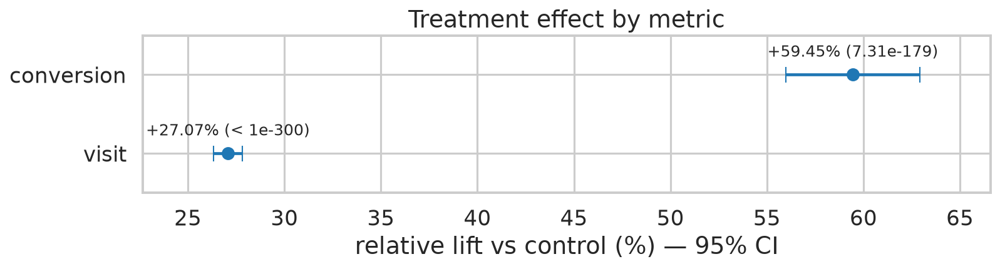
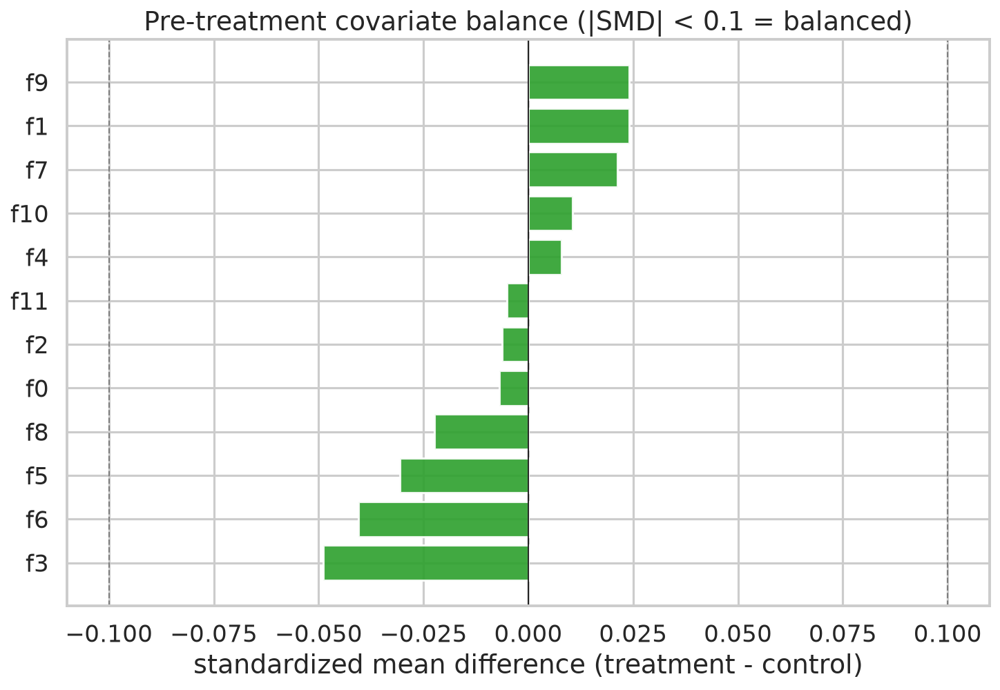
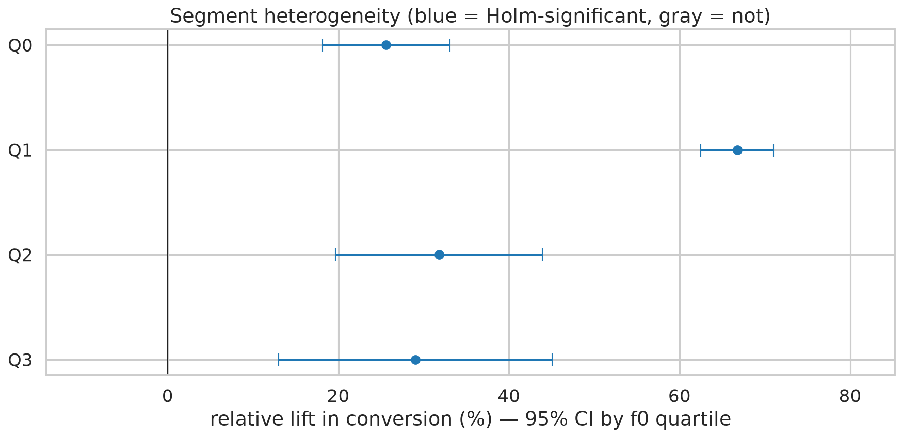
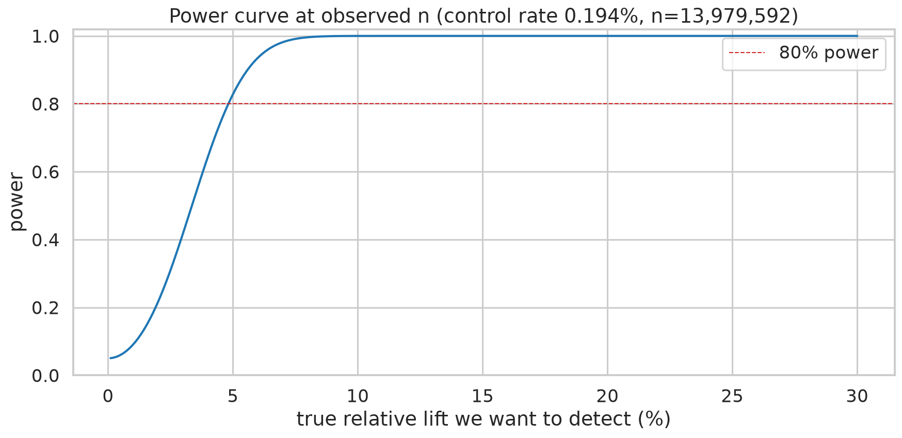

# Criteo Incrementality Experiment: Large-Scale A/B Testing & Validity Audit

An end-to-end causal inference and experimentation audit over **13,979,592 users** from the [Criteo Uplift Prediction Benchmark](https://huggingface.co/datasets/criteo/criteo-uplift). 

**Core Question:** Does serving digital display ads causally drive incremental conversions and site visits, and is the randomized assignment robust against large-sample anomalies and composition bias?

---

## Summary

| Dimension | Result & Evaluation | Audit Verdict |
|---|---|:---:|
| **Primary (Conversion)** | 0.1938% → 0.3089% — **+0.115 pp (+59.4% rel)**, 95% CI [+0.109, +0.122] pp, $z = 28.5$, $p = 7.31\times10^{-179}$ | **Significant** ✅ |
| **Secondary (Visit)** | 3.820% → 4.854% — **+1.034 pp (+27.1% rel)**, $z = 65.2$, $p < 1\text{e-}300$ (underflow) | **Significant** ✅ |
| **Multiplicity** | Holm-Bonferroni step-down across primary and secondary metrics | **Survives FWER** ✅ |
| **The Exposure Trap** | Restricting to *exposed* treated users shows a **+2,675.8%** naive lift — a post-treatment selection artifact (CACE/IV is the principled alternative) | **ITT Preserved** ✅ |
| **Covariate Balance** | Pre-treatment features balance across arms (max \|SMD\| = 0.049, threshold < 0.10) | **Balanced** ✅ |
| **Share Stability** | 5 discrete features show raw range drift up to 15.5 pp ($f_3$), but mass-weighted SD is $< 0.62$ pp and **>97.9% of users reside in balanced strata** | **Negligible Drift** ✅ |
| **Omnibus C2ST** | Balanced 1M-row GBDT reaches **OOF AUC 0.5095** vs a permuted null of 0.5015 ± 0.003 (gap **+0.008**, well below 0.05 materiality threshold) | **Exchangeable** ✅ |
| **Robustness** | Direct post-stratification lands conversion at **81.2%–95.3% of crude** (visit: 86.1%–96.9%) — sign and magnitude survive every adjustment | **Robust** ✅ |
| **Segments ($f_0$ quartiles)** | All 4 bins Holm-significant (+25.6% to +66.8%); **Bin 1 is the standout** (5× higher base rate, +66.8% lift; non-monotonic) | **Directional** ✅ |
| **Power** | 80%-power MDE = **+4.8% relative**; observed effect is $\approx 12\times$ that — null is firmly ruled out | **Well Powered** ✅ |
| **Decision Call** | **GREENLIGHT the campaign; discount financial CAC/ROAS projections to the standardized bounds (+48% to +56% rel)** | **SHIP** ✅ |

---

## Visual Summary

| Primary & Secondary Lift | Covariate Balance (SMD) |
| :---: | :---: |
|  |  |
| **Segment Heterogeneity ($f_0$)** | **Retrospective Power Curve** |
|  |  |

---

## Methodological & Engineering Decisions

* **Pre-Registered Protocol:** Hypotheses, primary/secondary metrics, $\alpha = 0.05$, decision rules, and validity gates were fixed prior to evaluating outcomes.
* **ITT Inference with Numerical Discipline:** Pooled two-proportion $z$-tests (pooled SE under $H_0$), unpooled Wald CIs for risk differences, Holm-Bonferroni FWER control, and floating-point underflow conventions (`< 1e-300`, avoiding bare `0.0` outputs).
* **Validity Beyond Balance Means:** Classical mean balance (SMD) is paired with treated-share independence tests across discrete levels and continuous quantiles, tracking mass-weighted dispersion to avoid false alarms from tail noise.
* **Omnibus C2ST Against an Empirical Null:** A `HistGradientBoostingClassifier` is trained on 1,000,000 class-balanced rows to detect multi-feature non-linear interactions. The out-of-fold AUC is evaluated against an empirically computed label-permuted baseline null distribution.
* **Tie-Safe Deterministic Quantile Binning:** Continuous features contain massive tied blocks (e.g., $f_0$ has one value covering 26.5% of rows). Because naive SQL `NTILE(ORDER BY f)` splits ties arbitrarily across runs, we use explicit quantile boundaries applied with half-open SQL `CASE` statements to ensure reproducible binning.
* **DuckDB Sampling Optimization Workaround:** DuckDB’s query optimizer pushes `USING SAMPLE` *below* `WHERE` filters, which silently destroys target sampling proportions when downsampling an unbalanced dataset. The C2ST sampler enforces an explicit materialization barrier to guarantee a true 50/50 arm balance.
* **Composition-Bias Robustness:** Direct standardization (G-computation) re-estimates treatment effects weighted by the pooled population stratum mix across all candidate drifted features.
* **Handling Post-Treatment Conditioning:** The notebook explicitly documents the selection bias introduced by conditioning on `exposure == True` (+2,675.8% naive lift), proving why ITT preserves causal identification.
* **Sub-Second Scale Ingestion:** The 297 MB gzipped CSV is queried directly in-memory via DuckDB with an explicit schema (`BOOLEAN` flags, `DOUBLE` features), processing 14M rows in ~6 seconds without disk decompression.

---

## Repository Architecture

```text
├── notebooks/
│   └── ab-test-analysis.ipynb    # Full executed narrative with all figures & tables
├── src/abtest/
│   ├── load.py       # gzip → in-memory DuckDB table (one pass, explicit schema)
│   ├── validity.py   # SMD balance, share independence, standardized ATE, omnibus C2ST
│   ├── inference.py  # Two-proportion z-tests, Wald CIs, Holm correction, Brent MDE
│   ├── segments.py   # Heterogeneous quantile effects with Holm step-down
│   └── plots.py      # Forest plots, balance charts, power curves
├── tests/            # 51 pytest tests (statsmodels cross-checks, tie determinism)
├── outputs/figures/  # Generated publication-ready figures
└── pyproject.toml    # Dependency specification (uv)
```

---

## Reproduction

```bash
# Environment Setup
git clone https://github.com/Jeffer512/ab-test-analysis.git && cd ab-test-analysis

# Using uv
uv sync --extra dev

# Using pip 
python -m venv .venv
source .venv/bin/activate   # On Windows: .venv\Scripts\activate
pip install -e ".[dev]"

# Download benchmark dataset (~297 MB, kept gzipped)
mkdir -p data && curl -L -o data/criteo-research-uplift-v2.1.csv.gz \
  https://huggingface.co/datasets/criteo/criteo-uplift/resolve/main/criteo-research-uplift-v2.1.csv.gz

# Open the notebook 
# Or execute it programatically with:
jupyter nbconvert --to notebook --execute --inplace notebooks/ab-test-analysis.ipynb
```

---

## Testing

```bash
pytest    # With venv active
# or
uv run pytest
```
Tests run on synthetic fixtures (no dataset download required).

---

## Data & Citation

Dataset: Criteo AI Lab, *Criteo Uplift Prediction Dataset v2.1*.  
Released with Diemert, Betlei, Renaudin, Amini, *"A Large Scale Benchmark for Uplift Modeling"*, AdKDD 2018 (KDD).  
Licensed under [CC-BY-NC-SA 4.0](https://creativecommons.org/licenses/by-nc-sa/4.0/). Features are anonymized, and assignment was non-uniformly subsampled by Criteo to prevent reverse-engineering proprietary commercial conversion levels.
